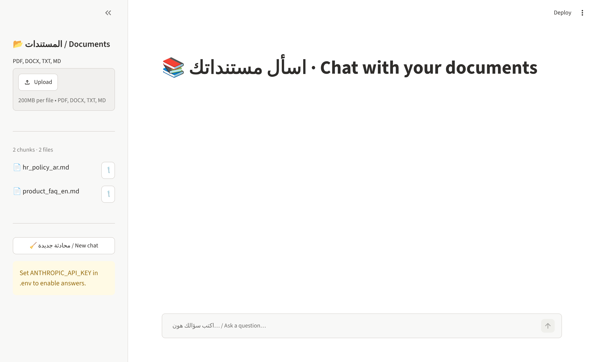
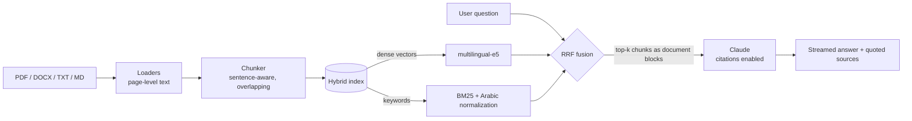

# 📚 Docs Chat · مساعد المستندات الذكي

[](../../actions/workflows/ci.yml)


An **Arabic-first RAG (Retrieval-Augmented Generation) assistant**. Upload your PDFs, Word files and notes, then ask questions in Arabic (any dialect) or English. Every answer comes with **citations that quote the exact passage** it relied on.

مساعد ذكي بيجاوبك من مستنداتك: ارفع ملفات PDF أو Word واسأل بالعربي أو الإنجليزي، والجواب بيجي مع **ذكر المصدر والنص الحرفي** اللي اعتمد عليه.



---

## ✨ Features

| | |
|---|---|
| 🔀 **Hybrid retrieval** | BM25 keyword search + dense multilingual embeddings, fused with **Reciprocal Rank Fusion**. Dense search catches meaning; BM25 catches exact names, numbers and codes. |
| 🇸🇦 **Arabic-aware search** | Custom normalization (أ/إ/آ → ا, ة → ه, ى → ي, diacritics & tatweel removed) and light stemming of the definite article «ال». |
| 📎 **Grounded, cited answers** | Each retrieved chunk is sent to Claude as a separate `document` block with **native citations** enabled, so sources are exact quotes, not guessed `[1]` markers. |
| ⚡ **Streaming** | Answers stream token-by-token in the UI and CLI. |
| 💬 **Follow-up questions** | Recent conversation turns are kept as context. |
| 💾 **Persistent index** | Built from scratch with NumPy (no vector-DB dependency), saved to disk, incremental add/remove per file. |
| 🧪 **Tested** | 24 unit tests + Ruff linting on GitHub Actions; the whole retrieval stack runs offline. |

## 🏗️ Architecture



```
rag/
├── loaders.py     # PDF (pypdf), DOCX (python-docx, incl. tables), TXT/MD
├── chunking.py    # sentence/paragraph-aware chunking with overlap (handles ؟ ، ؛)
├── text.py        # Arabic normalization, tokenization, stop words
├── embeddings.py  # sentence-transformers (multilingual-e5) + offline hashing fallback
├── store.py       # BM25 + dense hybrid index, RRF, save/load
├── llm.py         # Claude call: document blocks, citations, streaming, refusal handling
└── pipeline.py    # high-level facade: ingest / retrieve / ask
app.py             # Streamlit chat UI
cli.py             # command-line interface
tests/             # pytest suite
```

## 🚀 Quick start

```bash
git clone https://github.com/<your-username>/rag-chatbot.git
cd rag-chatbot
python -m venv .venv && source .venv/bin/activate
pip install -r requirements.txt
cp .env.example .env        # then put your ANTHROPIC_API_KEY in .env
streamlit run app.py
```

Open http://localhost:8501, upload files from the sidebar (or try the ones in `sample_docs/`), and start asking.

### CLI

```bash
python cli.py ingest sample_docs/*.md
python cli.py search "شو سياسة العمل من البيت؟"    # retrieval only, no API key needed
python cli.py ask "How long is the refund window for annual plans?"
python cli.py chat                                   # interactive
```

### Example (illustrative)

> **س:** كم يوم إجازة سنوية بيحقلي؟
>
> **ج:** بيحقلك **21 يوم عمل** إجازة سنوية مدفوعة، وبتصير **30 يوم** بعد ما تكمّل خمس سنين بالشركة. ولازم تقدّم الطلب قبل أسبوعين على الأقل.
>
> 📎 *hr_policy_ar.md: «يحق لكل موظف بدوام كامل الحصول على إجازة سنوية مدفوعة الأجر مدتها 21 يوم عمل…»*

## ⚙️ Configuration

All settings are environment variables (see `.env.example`):

| Variable | Default | Description |
|---|---|---|
| `ANTHROPIC_API_KEY` | – | Claude API key |
| `RAG_MODEL` | `claude-opus-5-5` | Claude model |
| `RAG_EFFORT` | `medium` | Reasoning effort: `low` / `medium` / `high` |
| `RAG_EMBEDDING_MODEL` | `intfloat/multilingual-e5-small` | Any sentence-transformers model |
| `RAG_TOP_K` | `6` | Chunks sent to the model |
| `RAG_CHUNK_SIZE` / `RAG_CHUNK_OVERLAP` | `900` / `150` | Characters per chunk and overlap |
| `RAG_INDEX_DIR` | `.rag_index` | Where the index is saved |

## 🧪 Development

```bash
pip install -r requirements-dev.txt
pytest -q
ruff check .
```

The tests use a deterministic offline embedder, so they need neither a GPU, a model download, nor an API key.

## 🧠 Design notes

- **Why RRF instead of weighted score averaging?** BM25 scores are unbounded while cosine similarities sit in [-1, 1]; ranks are comparable without any calibration ([Cormack et al., 2009](https://plg.uwaterloo.ca/~gvcormac/cormacksigir09-rrf.pdf)).
- **Why native citations?** Asking a model to write `[1]` markers is fragile. With citations enabled, the API returns the exact cited span of each document, so every source shown in the UI is a real quote.
- **Why E5 prefixes?** `multilingual-e5` was trained with `query:` / `passage:` prefixes; using them noticeably improves retrieval.
- **Re-uploading a file** replaces its old chunks, so the index never holds stale duplicates.

## 🗺️ Roadmap

- [ ] OCR for scanned PDFs
- [ ] Cross-encoder re-ranking stage
- [ ] Retrieval evaluation set (hit-rate / MRR) for Arabic questions
- [ ] Docker image + one-click deploy to Hugging Face Spaces

## 📄 License

MIT
